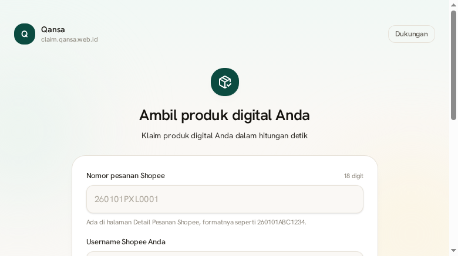
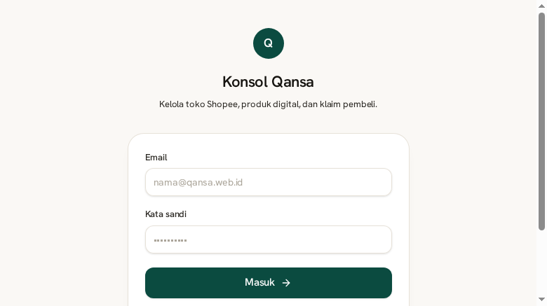
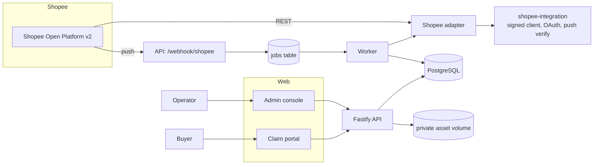

# Qansa Digital Delivery

Automatic fulfilment for digital products sold on Shopee. A buyer pays in Shopee, the order arrives by
push notification (or by the reconciliation sweep when a push never comes), the seller's product is
mapped to that exact variation, and the buyer collects it from `claim.qansa.web.id` after proving the
order is theirs. Nobody copies a link into a chat by hand.

- **Buyer portal** — one form, two verification factors, the product in hand in under a minute, and a
  manual route for the buyer Shopee's masked phone leaves stranded.
- **Admin console** — stores, catalogue sync, product mapping, digital products, orders, claims,
  manual verification queue, monitoring, users, security, audit trail.
- **Worker** — the queue, retries, dead letters, reconciliation, claim expiry, retention.

## Status

| Area                           | State                                                                                    |
| ------------------------------ | ---------------------------------------------------------------------------------------- |
| Database schema and migrations | 25 tables, applied against PostgreSQL 17                                                 |
| API                            | 49 routes, typed end to end (Zod at every boundary)                                      |
| Buyer portal                   | Working: verified against a real order, code and file delivery, plus manual verification |
| Admin console                  | 14 pages, all wired to the API                                                           |
| Automated tests                | 256 tests across 23 files: unit, integration, HTTP journey, worker                       |
| Smoke test                     | `scripts/smoke.mjs` passes against a live API + worker + PostgreSQL                      |
| Shopee connection              | `fixture` mode verified; `live` mode needs partner credentials (see below)               |
| Docker                         | Multi-stage images for API/worker and web, compose stack, nginx                          |

The pipeline, the claim verification, the signed download links and the mapping rules are implemented
and tested. What is **not** proven is a live Shopee round trip: no partner credentials were available
in this environment, so `SHOPEE_GATEWAY_MODE` defaults to `fixture` and every screen labels a fixture
store as simulated. `docs/shopee-integration.md` lists the exact steps to switch to live.

## Screenshots

| Buyer portal                                       | Console overview                                 |
| -------------------------------------------------- | ------------------------------------------------ |
|  |  |

| Catalogue and mapping                          | Orders                                       |
| ---------------------------------------------- | -------------------------------------------- |
|  |  |

## Architecture



| Component                   | Responsibility                                                        | Why this shape                                               |
| --------------------------- | --------------------------------------------------------------------- | ------------------------------------------------------------ |
| `apps/web`                  | Claim portal and console, one Next.js app on two hostnames            | Same design system, one deploy, host routing in `proxy.ts`   |
| `apps/api`                  | HTTP surface, sessions, RBAC, claim verification, delivery            | Stateless; can scale horizontally behind nginx               |
| `apps/worker`               | Queue consumer, catalogue sync, order pipeline, expiry sweep          | Separate process so a slow Shopee call never blocks a buyer  |
| `packages/services`         | Domain logic shared by API and worker                                 | The pipeline is written once and tested once                 |
| `packages/core`             | Pure rules: state machine, eligibility, mapping, verification, crypto | No I/O, so the rules are cheap to test and hard to bypass    |
| `packages/db`               | Drizzle schema, migrations, pglite test database                      | Real SQL in tests without a container                        |
| `vendor/shopee-integration` | Signed client, OAuth, push signature (git submodule, pinned)          | Shopee protocol code stays in one place, versioned by commit |

Full rationale in [`docs/architecture.md`](docs/architecture.md).

## Repository layout

```
apps/
  api/        Fastify API, routes, auth, bootstrap entry
  worker/     job loop and handlers
  web/        Next.js 16 app (claim portal + admin console)
packages/
  core/       state machine, eligibility, mapping, claim rules, crypto
  db/         Drizzle schema, SQL migrations, seed, pglite test harness
  services/   pipeline, claims, sync, queue, settings, audit
  shopee-adapter/  gateway interface + live/fixture implementations
vendor/
  shopee-integration/  git submodule of indraoverflow/shopee-integration
docker/       Dockerfiles, nginx config
docs/         architecture, schema, integration, fulfilment, security, API, deployment, ops
scripts/      smoke test
```

## Quick start

### Docker Compose (recommended)

```bash
git clone --recurse-submodules git@github.com:indraoverflow/shopee-digital-delivery.git
cd shopee-digital-delivery
cp .env.example .env
# fill in APP_ENCRYPTION_KEY and DOWNLOAD_SIGNING_SECRET: openssl rand -hex 32
docker compose up -d --build
```

The `migrate` container applies migrations and creates the owner account before the API starts. Watch
its log once:

```bash
docker compose logs migrate
```

- portal: <http://localhost:3000>
- console: <http://localhost:3000/admin> (same app; hostnames split it in production)
- API: <http://localhost:4000/health>
- optional nginx with the three hostnames: `docker compose --profile proxy up -d`

### Local development

Requirements: Node 22 (`nvm use`), pnpm 10+, PostgreSQL 15+.

> Build the web app on Node 22. Next 16.4.6 fails to prerender its global error page on Node 26
> (`Cannot read properties of null (reading 'useContext')`); the Docker image and CI both use Node 22,
> which is why `.nvmrc` pins it.

```bash
git submodule update --init --recursive
pnpm install
pnpm --filter shopee-integration build       # the vendor package exposes compiled types

cp .env.example .env                          # DATABASE_URL, keys, ports
pnpm --filter @qansa/db migrate               # applies drizzle/*.sql
pnpm --filter @qansa/db seed                  # owner account + default settings

pnpm dev:api      # :4000
pnpm dev:worker   # queue
pnpm dev:web      # :3000
```

Then load the demo data through the console: add a store with shop id `771001`, press **Sambungkan
(simulasi)**, **Sinkron produk**, create a digital product with codes, map the variations, **Sinkron
pesanan**. The fixture order `260101PXL0001` becomes claimable with buyer username `rina_kurnia`.

Verify the whole path without clicking:

```bash
node --env-file=.env scripts/smoke.mjs
```

## Configuration

Everything is documented in [`.env.example`](.env.example). The values that matter:

| Variable                                              | Purpose                                                              |
| ----------------------------------------------------- | -------------------------------------------------------------------- |
| `APP_ENCRYPTION_KEY`                                  | 32-byte hex key (AES-256-GCM) for Shopee tokens and activation codes |
| `DOWNLOAD_SIGNING_SECRET`                             | HMAC key for expiring download links                                 |
| `SHOPEE_GATEWAY_MODE`                                 | `fixture` (sample data) or `live` (real API)                         |
| `SHOPEE_PARTNER_ID` / `SHOPEE_PARTNER_KEY`            | Credentials from the Open Platform console                           |
| `SHOPEE_PUSH_URL`                                     | Exact public push URL; the signature covers it                       |
| `SHOPEE_REDIRECT_URL`                                 | OAuth callback registered for the app                                |
| `CLAIM_ORIGIN` / `ADMIN_ORIGIN` / `API_PUBLIC_ORIGIN` | Public origins used for CORS and download links                      |
| `UPLOAD_DIR`                                          | Private volume for digital assets (shared by API and worker)         |
| `ADMIN_EMAIL` / `ADMIN_PASSWORD`                      | Owner account created at first boot                                  |

Secrets are never read by the browser: the API returns token _expiry_, never a token.

## How fulfilment works

```
Shopee push (code 3) ──▶ signature check over the raw body ──▶ webhook_events row (unique body hash)
        │                                                              │
        └── duplicate ──▶ acknowledged, no work                        ▼
                                                    jobs: PROCESS_ORDER (dedupe: store + order)
                                                                       │
                                        worker claims the job (FOR UPDATE SKIP LOCKED)
                                                                       │
                        GET /order/get_order_detail ──▶ upsert order + items by Shopee ids
                                                                       │
                            mapping resolution (variation wins over listing) ──▶ fulfilments
                                                                       │
                            eligibility (paid? cancelled?) ──▶ state machine ──▶ order_events
                                                                       │
                                                          buyer claims from the portal
```

- Failures retry with exponential backoff (30s → 30min), then land in a dead letter visible in
  Monitoring.
- A push is never trusted as state: it only names an order, the detail call decides.
- Reconciliation runs on a schedule over `update_time`, which catches pushes that never arrived.
- Duplicate pushes, duplicate jobs and duplicate details all converge on the same rows.

Details, including the full state diagram, in [`docs/order-fulfillment.md`](docs/order-fulfillment.md).

## Testing

```bash
pnpm test         # 256 tests: core rules, SQL/migrations, pipeline, claims, security, shipping, HTTP journey, worker
pnpm typecheck    # every package and app, strict mode
pnpm -r build     # vendor, API/worker bundles, Next.js production build
```

Tests run against **pglite** (PostgreSQL compiled to WASM) with the real migrations applied, and the
**fixture** Shopee gateway. No container, no network, no credentials. The HTTP journey test logs in,
connects a store, syncs the catalogue, maps a variation, receives a push, claims the product and
revokes the claim, all through Fastify's injector.

`scripts/smoke.mjs` is the other half: it runs the same path against a _running_ stack with a real
PostgreSQL, which is what CI cannot prove. `scripts/preflight.mjs` is the go-live gate: environment,
service, tokens, dead letters, audit chain, public hostnames, and a signed push against a forged one.
`scripts/verify-s3.ts` does the same for object storage: it writes, reads and deletes an object against
any S3-compatible endpoint, so the hand-written SigV4 signer is checked against a real server and not
only against a mock.

```bash
S3_ENDPOINT=http://127.0.0.1:19000 S3_BUCKET=qansa-assets \
S3_ACCESS_KEY_ID=qansa S3_SECRET_ACCESS_KEY=qansa-s3-secret \
npx tsx scripts/verify-s3.ts
```

## Security

Short version: scrypt password hashes, optional TOTP two-factor with single-use recovery codes, opaque
session tokens stored as sha256, CSRF header on every mutation, RBAC with four roles, AES-256-GCM at
rest for tokens, codes and 2FA secrets, HMAC push verification over the raw body, signed expiring
download links, per-IP and per-order claim rate limits, optional console IP allow list, upload allow
list with a path-traversal guard, hash-chained audit log, and a rotation procedure for the encryption
key. Threat model and residual gaps in [`docs/security.md`](docs/security.md).

## Documentation

- [`docs/architecture.md`](docs/architecture.md) — decisions, sequence diagrams, scaling
- [`docs/database-schema.md`](docs/database-schema.md) — tables, constraints, retention
- [`docs/shopee-integration.md`](docs/shopee-integration.md) — repository audit, protocol, going live
- [`docs/order-fulfillment.md`](docs/order-fulfillment.md) — state machine and pipeline
- [`docs/drive-delivery.md`](docs/drive-delivery.md) — delivering through Google Drive, and its limits
- [`docs/security.md`](docs/security.md) — controls and known gaps
- [`docs/api-reference.md`](docs/api-reference.md) — every endpoint
- [`docs/deployment.md`](docs/deployment.md) — compose, domains, backups, upgrades
- [`docs/production-readiness-report.md`](docs/production-readiness-report.md) — audit, findings, readiness
- [`docs/live-shopee-checklist.md`](docs/live-shopee-checklist.md) — the ordered path from fixture to live
- [`docs/domain-runbook.md`](docs/domain-runbook.md) — example.com on a second Cloudflare account, and the Shopee application
- [`docs/remaining-work.md`](docs/remaining-work.md) — what is still open, and how it closes
- [`docs/saas-tenant-design.md`](docs/saas-tenant-design.md) — multi-tenant SaaS decisions, design only
- [`docs/troubleshooting.md`](docs/troubleshooting.md) — symptom → cause → fix

## Known limitations

- **Live Shopee round trip is unverified.** No partner credentials here. The adapter, signing and
  OAuth reuse are tested against fixtures only.
- **Phone-based verification depends on Shopee's mask.** When the order returns no phone, the
  `USERNAME_PHONE` policy fails closed and the buyer is routed to manual verification, which needs an
  operator to check the order out of band.
- **Digital listings on Shopee still need a shipping method.** Sellers typically use a zero-weight
  courier option; the platform does not change Shopee listing setup.
- **One asset per file product**, 50 MB each. Set `ASSET_STORE=s3` to move assets to object storage;
  the local driver stays the default.
- **Notifications are one outbound webhook**, not email. It reaches Slack, n8n or the WhatsApp gateway
  already running on this host; there is no SMTP client in the image.
- **WAF is deployment-side.** Cloudflare in front is the recommended shape; `docker/nginx.conf` also
  ships `limit_req` zones for the case where nginx terminates TLS directly.
- Shopify, Tokopedia, TikTok Shop: not implemented. The gateway interface is where they would plug in.

## License

MIT.
