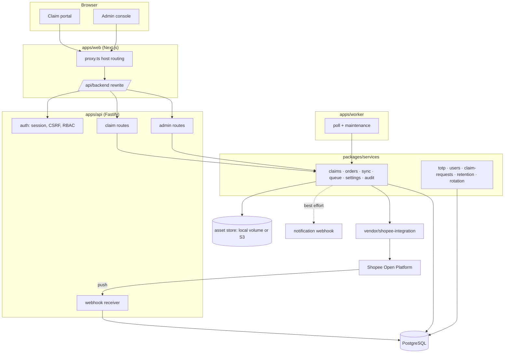
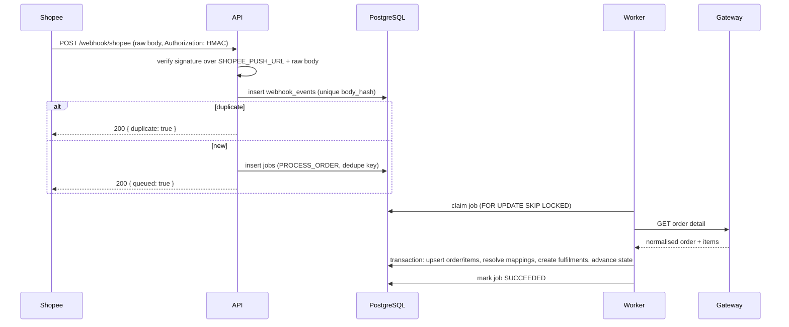
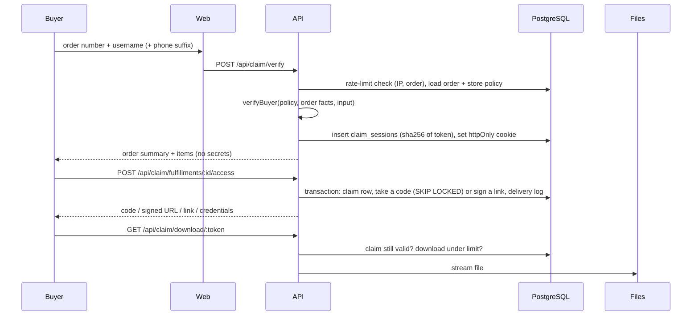

# Architecture

## Problem

A Shopee seller lists a digital product. Shopee collects money and reports an order. Everything after
that is normally manual: read the order, find the buyer, send the file or the code, hope they do not
share it. The platform replaces that manual step and nothing else: Shopee stays the system of record
for orders and payment, Qansa decides what the buyer is entitled to and hands it over safely.

## Constraints that shaped the design

1. **Shopee is the source of truth.** Order state, payment state and cancellation can change at any
   time, and the only authoritative view is the Order API. A push is a hint that something changed.
2. **No guaranteed delivery of pushes.** Shopee retries, may deliver twice, and sometimes never
   delivers. Idempotency and reconciliation are not optional.
3. **The order number is public.** It appears in emails, screenshots and chat. Verification needs a
   second factor the buyer actually owns.
4. **Digital goods leak.** A URL that escapes is a refund. Every delivery needs an expiring,
   revocable grant.
5. **Small team, homelab deployment.** Every extra service is another thing to back up at 2am.

## Decisions

### 1. Reuse `shopee-integration` as a pinned submodule, not a rewrite

The existing repository already implements the parts that are easy to get subtly wrong: the HMAC base
string per API class, OAuth, single-use refresh tokens, push signature verification over the raw body,
and order listing by `update_time`. Rewriting that in a second repository would create two places to
fix when Shopee changes something.

It is consumed as a git submodule at `vendor/shopee-integration`, linked through the pnpm workspace,
and wrapped by `packages/shopee-adapter`:

- `ShopeeGateway` — the interface the business code depends on (`getOrders`, `listProducts`,
  `refreshToken`, …).
- `LiveShopeeGateway` — delegates to the vendored client and normalises Shopee's loosely typed
  payloads into shapes with real types (`NormalisedOrder`, `NormalisedProduct`).
- `FixtureShopeeGateway` — same interface, deterministic data. Used by every automated test and by
  any deployment that runs before partner approval.

Consequence: swapping to another marketplace means implementing one interface, and pointing the
adapter at a new gateway never touches the pipeline.

Rejected alternative: calling the service's HTTP endpoints. The existing service is a _receiver_
(webhook, token store, one shop call). It does not expose order details or catalogue reads, and
turning it into a network dependency would add a hop and a failure mode without adding a boundary.

### 2. PostgreSQL as the queue

`jobs` is a table with `status`, `attempts`, `run_at` and a partial unique index on `dedupe_key`. The
worker claims work with `SELECT … FOR UPDATE SKIP LOCKED`.

At this volume (hundreds of jobs a day, thousands at peak) Redis would add a second store to back up,
a second failure mode, and a second thing to monitor, for no throughput this system needs. The queue's
guarantees — at-least-once, retry with backoff, dead letter, dedupe — are all expressible in SQL, and
the whole history stays queryable for the monitoring page.

Consequence: the worker and the API must share one database. That is already true, and it is the same
trade-off every job system with an outbox makes.

### 3. Drizzle + pglite for tests

`drizzle-orm` keeps SQL visible, so an index or a constraint is one glance away from the code that
needs it, and migrations are plain `.sql` files under `packages/db/drizzle`.

Tests run against `@electric-sql/pglite`: the real PostgreSQL engine compiled to WASM, with the real
migrations applied. That means unique constraints, partial indexes, `FOR UPDATE SKIP LOCKED` and
transactions behave in tests exactly as in production, and CI needs no service container.

Consequence: one `Database` type (`PgDatabase<PgQueryResultHKT, typeof schema>`) is shared by both
drivers; services accept it and do not know which one they got.

### 4. One Next.js app, two hostnames

`claim.qansa.web.id` and `admin.qansa.web.id` serve the same build. `proxy.ts` rewrites based on the
`Host` header, so there is one design system, one deploy, one set of components, and the console is
still unreachable from the claim hostname.

Browsers talk only to the web app. `/api/backend/*` is rewritten to the Fastify API, which keeps the
session cookie first-party and avoids a CORS preflight on every request. The API keeps its own CORS
allow list for direct calls and for the local development case.

### 5. Services in a package, HTTP at the edge

`packages/services` holds every mutation that matters. The API routes validate input, check
permissions and call a service; the worker calls the same services from a job. Nothing in a route
handler writes business state directly, which is why a webhook-triggered order and a
reconciliation-triggered order cannot diverge.

## Components

## Seams that keep optional parts optional

Four pieces are optional at runtime, and each is a single interface so the default deployment needs
nothing extra:

| Seam | Default | Alternative | Why it is a seam |
|---|---|---|---|
| Asset storage (`AssetStore`) | local volume | any S3-compatible bucket | Moving files must not touch claim or delivery code |
| Notifications (`notify`) | disabled | one signed webhook | Slack, n8n and the WhatsApp gateway all speak HTTP |
| Console access | open | `ADMIN_IP_ALLOWLIST` | A homelab deployment may want the fence; a distributed team may not |
| Second factor | off per account | TOTP per user | Enforced by the account, not by an environment variable |

## Two flows, end to end

### A push becomes a claimable order

### A buyer collects the product

## Failure modes and what happens

| Failure                                   | Behaviour                                                                                        |
| ----------------------------------------- | ------------------------------------------------------------------------------------------------ |
| Push never arrives                        | Scheduled reconciliation by `update_time` picks the order up                                     |
| Push arrives twice                        | Body hash unique index → `duplicate`, no second job                                              |
| Push arrives late (order already claimed) | `planTransition` finds no path backwards; a `STATE_HELD` event records why                       |
| Shopee API 5xx / timeout                  | Job retried with backoff; Monitoring shows the attempt and the error                             |
| Token expired mid-flight                  | `getStoreAccess` refreshes before use and persists the new pair                                  |
| Refresh token rejected                    | Store marked `ERROR`, monitoring alert, seller re-authorizes                                     |
| Worker crashes mid-job                    | Lock goes stale, `recoverStuckJobs` re-queues it after 15 minutes                                |
| Code pool empty                           | Reveal fails with `OUT_OF_STOCK`, buyer sees a support message, admin sees the alert             |
| Order cancelled after delivery            | Fulfilment and claims revoked; existing download links die because the route re-checks the claim |
| Mapping points at a DRAFT product         | Fulfilment stays `PENDING` with `PRODUCT_NOT_ACTIVE`; nothing is served                          |

## Scaling

- **API** is stateless (session state is in PostgreSQL): run as many replicas as needed behind nginx.
- **Worker** is horizontally safe: the queue lock guarantees one worker per job. Add replicas for
  throughput, not correctness.
- **Web** scales like any Next.js app; it holds no state.
- The first bottleneck will be the Shopee rate limit, not this stack. The adapter requests one order
  detail page per 50 orders and one item page per 50 items; when Shopee starts answering 429 the job
  backs off instead of hammering.

## What is deliberately not here

- No microservices: one API, one worker, shared code through packages.
- No Redis, no message broker, no service mesh.
- No client-side state library: the console pages fetch with one small hook.
- No ORM magic: every query is visible in the file that needs it.
