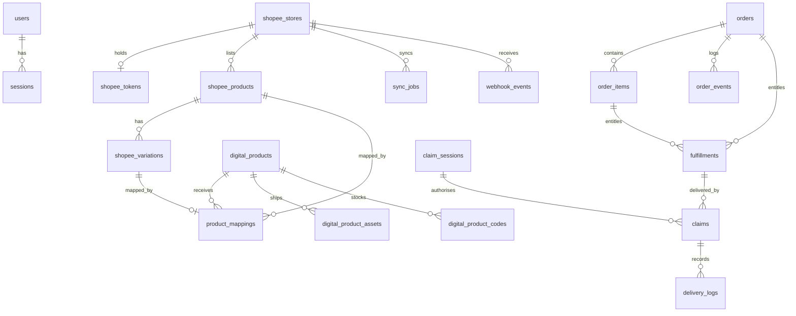

# Database schema

PostgreSQL 15+ (17 in compose). Migrations are plain SQL in `packages/db/drizzle`, generated by
drizzle-kit from `packages/db/src/schema.ts` and applied by the `migrate` container or
`pnpm --filter @qansa/db migrate`.

Conventions: `uuid` primary keys (`gen_random_uuid()`), `timestamptz` for every time, `numeric(14,2)`
for money, `jsonb` only for payloads kept for diagnosis.

## Entity map



## Groups

### Identity and access

| Table      | Key columns                                                  | Notes                                                    |
| ---------- | ------------------------------------------------------------ | -------------------------------------------------------- |
| `users`    | `email` (unique, lower-cased index), `password_hash`, `role`, `totp_secret_enc`, `recovery_code_hashes` | scrypt hash, TOTP secret encrypted with the app key |
| `sessions` | `token_hash` (unique), `expires_at`, `revoked_at`            | The cookie carries the token, the row carries its sha256 |
| `login_challenges` | `token_hash` (unique), `expires_at`, `attempts`, `consumed_at` | The half-authenticated 2FA step: 5 minutes, single use, 5 tries |

Roles: `OWNER`, `ADMIN`, `OPERATOR`, `VIEWER`. Permissions live in code
(`packages/core/src/permissions.ts`) so a role change cannot leave a stale grant.

### Shopee

| Table               | Key columns                                                                                          | Notes                                                     |
| ------------------- | ---------------------------------------------------------------------------------------------------- | --------------------------------------------------------- |
| `shopee_stores`     | `(environment, shop_id)` unique, `status`, `verification_policy`, `eligible_statuses`, `brand_name`  | Per-store branding and eligibility override               |
| `shopee_tokens`     | `store_id` unique, `access_token_enc`, `refresh_token_enc`, `expires_at`                             | AES-256-GCM; refresh tokens are single use                |
| `shopee_products`   | `(store_id, item_id)` unique, `deleted_at`                                                           | Soft delete keeps mapping history                         |
| `shopee_variations` | `(product_id, model_id)` unique, `deleted_at`                                                        | `model_id` is Shopee's variation id                       |
| `product_mappings`  | unique on `shopee_variation_id` where it is not null, unique on `shopee_product_id` where it is null | Two partial indexes enforce "one live mapping per target" |

### Digital products

| Table                    | Key columns                                                                     | Notes                                                               |
| ------------------------ | ------------------------------------------------------------------------------- | ------------------------------------------------------------------- |
| `digital_products`       | `slug` unique, `delivery_kind`, `status`, `claim_expiry_days`, `max_deliveries` | Archived, never deleted                                             |
| `digital_product_assets` | `digital_product_id`, `storage_key`, `sha256`, `size_bytes`                     | One file per product; the storage key never leaves the server       |
| `digital_product_codes`  | `digital_product_id`, `secret_enc`, `label`, `assigned_claim_id`                | Encrypted secret, masked label for the admin list, unique per claim |

### Orders

| Table            | Key columns                                                                               | Notes                                                                 |
| ---------------- | ----------------------------------------------------------------------------------------- | --------------------------------------------------------------------- |
| `orders`         | `(store_id, order_sn)` unique, `state`, `shopee_status`, `ineligible_reason`, `synced_at` | The unique pair is the idempotency key                                |
| `order_items`    | `(order_id, line_key)` unique, `mapping_status`, `digital_product_id`                     | `line_key = itemId:modelId`                                           |
| `order_events`   | `order_id`, `type`, `from_state`, `to_state`, `payload`                                   | Append-only timeline                                                  |
| `fulfillments`   | `(order_item_id, digital_product_id)` unique, `status`, `claim_deadline`                  | What the buyer is entitled to                                         |
| `claim_sessions` | `token_hash` unique, `expires_at`                                                         | One verified order per session                                        |
| `claims`         | `fulfillment_id`, `status`, `deliveries_used`, `revoked_at`                               | Unique per (fulfilment, session)                                      |
| `claim_attempts` | `order_sn`, `ip`, `success`, `reason`                                                     | Rate limiting and abuse analysis                                      |
| `delivery_logs`  | `claim_id`, `kind`, `reference`, `ip`                                                     | Reveals carry `reference = 'reveal'`; downloads carry the storage key |
| `claim_requests` | `order_id` (one pending per order, partial unique), `status`, `contact`, `approved_until`  | Manual verification queue and its time-boxed approval window          |

### Operations

| Table             | Key columns                                                                             | Notes                                   |
| ----------------- | --------------------------------------------------------------------------------------- | --------------------------------------- |
| `jobs`            | `type`, `payload`, `dedupe_key` (unique among `QUEUED`/`RUNNING`), `run_at`, `attempts` | Table-backed queue                      |
| `webhook_events`  | `body_hash` unique, `signature_valid`, `status`, `order_sn`                             | Duplicate guard and audit of every push |
| `sync_jobs`       | `store_id`, `type`, `status`, `stats`, `error`                                          | One row per manual or scheduled sync    |
| `audit_logs`      | `action`, `actor_label`, `target_type`, `target_id`, `metadata`, `seq`, `prev_hash`, `entry_hash` | Hash-chained administrative actions |
| `system_settings` | `key` primary key, `value` jsonb                                                        | `branding`, `claim`, `sync`, `notify`   |

## Indexes that matter

| Index                                                         | Query it serves                            |
| ------------------------------------------------------------- | ------------------------------------------ |
| `orders_store_sn_key`                                         | Idempotent upsert by order number          |
| `orders_state_idx`, `fulfillments_status_idx`                 | Dashboard counters and the claimable queue |
| `claim_attempts_ip_idx`, `claim_attempts_sn_idx`              | Rate limiting windows                      |
| `jobs_poll_idx (status, run_at)`                              | Worker claim query                         |
| `jobs_dedupe_key` (partial, `status in ('QUEUED','RUNNING')`) | One pending job per unit of work           |
| `webhook_events_body_hash_key`                                | Duplicate push detection                   |
| `product_mappings_variation_key` / `_item_key` (partial)      | "One live mapping per variation/listing"   |

## Retention

| Data                        | Policy                                                                 |
| --------------------------- | ---------------------------------------------------------------------- |
| `sessions`                  | Deleted or expired after 12 h; revoked rows can be pruned weekly       |
| `claim_sessions`            | Expire after 30 min; prune anything older than 7 days                  |
| `webhook_events`            | Keep 90 days for diagnosis, then prune                                 |
| `delivery_logs`             | Keep as long as the order is auditable (regulatory default: 24 months) |
| `audit_logs`                | 24 months                                                              |
| `jobs` (SUCCEEDED)          | Prune after 30 days; `DEAD` kept until investigated                    |
| Orders, claims, fulfilments | Never deleted; they are the financial record                           |

These are enforced by `runRetentionSweep` in `packages/services/src/retention.ts`, scheduled daily by
the worker as a `RETENTION_SWEEP` job and runnable on demand from **Keamanan**. It also deletes expired
`login_challenges`, expires manual `claim_requests` nobody answered (default 3 days) and closes
approval windows that have passed. Manual SQL is never the operating procedure; the sweep is audited
with the counts it removed.

## Migration workflow

```bash
# after editing packages/db/src/schema.ts
pnpm --filter @qansa/db generate     # writes drizzle/NNNN_name.sql + snapshot
pnpm --filter @qansa/db migrate      # applies to DATABASE_URL
```

Rules:

- Never edit an applied migration; add another.
- The API refuses to start if `select 1 from users` fails, so a missing migration fails at boot with
  `database schema mismatch` instead of at a customer's first claim.
- Dropping a column requires a two-step deploy (stop reading, then drop).
- Tests run the same migrations against pglite, so a broken migration fails CI, not production.
