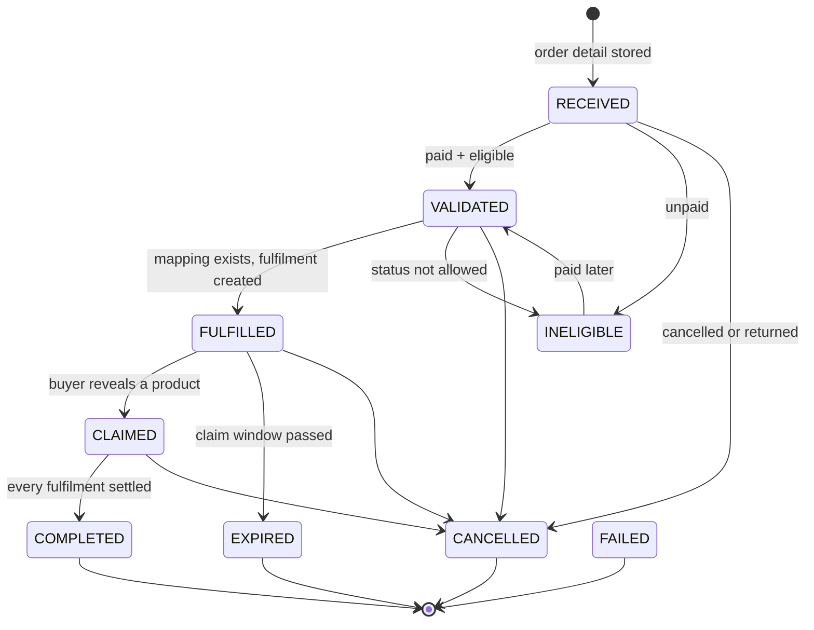

# Order fulfilment

## The promise

A paid Shopee order for a mapped listing becomes a claimable digital product without a human in the
loop, exactly once, and stays claimable until its window closes.

## Where the truth lives

| Fact                     | Source                                                            |
| ------------------------ | ----------------------------------------------------------------- |
| Payment and order status | Shopee `order_status` (via Order API)                             |
| What was bought          | Shopee `order_detail.item_list` (`item_id`, `model_id`, quantity) |
| What the buyer gets      | `product_mappings` → `digital_products`                           |
| Whether it was delivered | `fulfillments`, `claims`, `delivery_logs`                         |

A push is only a signal. Its payload names an order number; the worker fetches the detail and decides.

## State machine

Rules enforced in `packages/core/src/order-state.ts`:

- A repeated push is a no-op (`from === to` is allowed).
- Nothing moves out of `COMPLETED`, `CANCELLED`, `EXPIRED` or `FAILED`.
- Multi-step jumps are legal only through the graph: `RECEIVED → FULFILLED` is walked as
  `RECEIVED → VALIDATED → FULFILLED`, with an event per hop, because an order is often first seen
  already paid.
- `UNPAID` is **not** a cancellation. It maps to `INELIGIBLE`, which can still become `VALIDATED`
  when the buyer pays a minute later. Only `CANCELLED`, `IN_CANCEL` and `TO_RETURN` revoke.

Every transition writes `order_events` with the Shopee status and the reason, and `STATE_HELD` when a
late push tried to move an order backwards.

## Eligibility

`evaluateEligibility` in `packages/core/src/eligibility.ts`:

| Shopee status                                                              | Result                                   | Revokes? |
| -------------------------------------------------------------------------- | ---------------------------------------- | -------- |
| `READY_TO_SHIP`, `PROCESSED`, `SHIPPED`, `TO_CONFIRM_RECEIVE`, `COMPLETED` | eligible                                 | no       |
| `UNPAID`                                                                   | `NOT_PAID`                               | no       |
| `CANCELLED`, `IN_CANCEL`, `TO_RETURN`                                      | `CANCELLED`                              | yes      |
| anything else or empty                                                     | `NOT_IN_ALLOWED_LIST` / `UNKNOWN_STATUS` | no       |

The allowed list is stored per store (`shopee_stores.eligible_statuses`) so a seller can require
`COMPLETED` only.

## Pipeline

`processOrderDetail` in `packages/services/src/orders.ts` — one transaction:

1. **Ensure catalogue stubs.** Each `item_id` in the order becomes a `shopee_products` row if the
   catalogue sync has not created it yet, so the mapping screen can show it immediately.
2. **Upsert the order** by `(store_id, order_sn)` with buyer, amounts, status and the raw payload.
3. **Upsert items** by `(order_id, line_key)` where `line_key = itemId:modelId`. A repeated push
   updates the same rows.
4. **Resolve mappings** (see below) and store `mapping_status`, `digital_product_id`,
   `unmapped_reason` per line.
5. **Create fulfilments** for mapped lines: one row per (order item, digital product), quantity is
   purchased × multiplier, deadline from the digital product's `claim_expiry_days`. A product that is
   `DRAFT`/`ARCHIVED` yields `PENDING` with `PRODUCT_NOT_ACTIVE` rather than a claimable row.
6. **Revoke on cancellation.** Every live fulfilment goes `REVOKED` and every live claim too.
7. **Advance the state** through the graph and write the events.

### Mapping precedence

1. An active mapping for the exact variation wins.
2. Otherwise an active listing-level mapping (no `shopee_variation_id`) covers all variations.
3. Two active mappings at the same level → `AMBIGUOUS`. The order stays `VALIDATED`, nothing is
   delivered, and the order page shows the reason. Guessing is how the wrong product ships.
4. No mapping → `UNMAPPED` with `NO_MAPPING` / `INACTIVE_ONLY`.

Unique partial indexes make case 3 impossible through the API: one mapping per variation and one per
listing.

### Quantity

`delivered_quantity = purchased × quantity_multiplier`, floored, never zero. A "5 licences" package
mapped with multiplier 5 delivers 5 units from a single purchase.

## Pushes

`POST /webhook/shopee`, inside `apps/api/src/routes/webhook.ts`:

1. Read raw bytes (custom JSON parser keeps them).
2. Verify `HMAC-SHA256(partner_key, SHOPEE_PUSH_URL + rawBody)` against `Authorization`, timing-safe,
   with the console test key as an alternate.
3. Insert `webhook_events` keyed by `sha256(rawBody)`. A conflict means Shopee retried: acknowledge
   `{ duplicate: true }` and do nothing.
4. Code `3` with an order number → enqueue `PROCESS_ORDER` (dedupe `order:<store>:<sn>`).
5. Code `2` → delete tokens, mark the store `DISCONNECTED`.
6. Anything else → `IGNORED`, recorded for monitoring.
7. Answer immediately: Shopee is waiting, and work belongs to the queue.

If `SHOPEE_PUSH_URL` is unset, signatures are not verified. That is allowed only outside production
and the store is flagged in Monitoring (`webhooks.configured: false`).

## Reconciliation

`runOrderSync` queries `get_order_list` with `time_range_field=update_time` over the lookback window
(default 72 h), fetches details 50 at a time, and runs each through the same pipeline. Scheduled every
`ORDER_RECONCILE_MINUTES` by the worker's maintenance tick.

Why `update_time`: a push that never arrived is invisible in a create-time query. Why the same
pipeline: a reconciliation-triggered order and a push-triggered order cannot end up in different
states.

## Claim and delivery

| Step    | Implementation       | Guarantee                                                                                       |
| ------- | -------------------- | ----------------------------------------------------------------------------------------------- |
| Verify  | `verifyClaim`        | Username (and phone suffix per policy), rate limited per IP and per order, every attempt logged |
| Session | `claim_sessions`     | 30-minute token, sha256 stored, scoped to one order, httpOnly cookie                            |
| Reveal  | `accessDelivery`     | One transaction: claim row, code taken with `SKIP LOCKED`, delivery log, order state            |
| File    | `resolveDownload`    | HMAC-signed link, 10-minute TTL, still checked against the claim and a download limit           |
| Revoke  | `revokeClaim`        | Kills the claim row, so every link already issued stops working                                 |
| Reissue | `reissueFulfillment` | Fulfilment back to `CLAIMABLE`, old claim kept as history                                       |
| Manual  | `claim_requests`     | Buyer asks, operator approves, username alone is accepted for that order until the window closes |

Delivery kinds:

| Kind           | What the buyer sees                  | Notes                                                                  |
| -------------- | ------------------------------------ | ---------------------------------------------------------------------- |
| `FILE`         | Download button with size and expiry | Streamed from a private volume; no storage path ever leaves the server |
| `LINK`         | "Buka akses produk"                  | Validated as a URL at input; no store-internal links                   |
| `CODE`         | The code, copyable                   | One code per claim, reused on a repeat visit, never shared             |
| `CREDENTIALS`  | Username and password rows           | Stored as encrypted JSON                                               |
| `INSTRUCTIONS` | Formatted text                       | For products delivered elsewhere                                       |

Limits: `digital_products.max_deliveries` reveals per claim (default 3), `claim.maxDownloadsPerFulfillment`
file downloads per claim (default 5). Both are configurable in Settings.

## The Shopee side of the order

Claiming is an internal event. The platform writes `orders.state`, `claims`, `fulfillments` and
`order_events`; it never writes anything back to Shopee, so a claimed order stays whatever Shopee
thinks it is. In practice that means an order the buyer has already collected can still show
**Perlu Dikirim / READY_TO_SHIP** in the seller centre.

That is not cosmetic: Shopee cancels an order that the seller never ships, and the buyer gets a refund
for a product they already received. Someone has to mark those orders shipped, and the platform does not
do it for you:

- Monitoring raises `AWAITING_SHIPMENT` with the count and the age of the oldest order, and lists the
  order numbers, so this is not discovered after the cancellation.
- The order page has **Tandai dikirim**, which calls Shopee's logistics `ship_order` for that one order
  (`POST /api/admin/orders/:id/ship`, permission `order:write`). It is idempotent and it refuses an order
  that was not delivered yet.
- Digital shops ship with **jasa kirim toko**, which Shopee treats as a non-integrated channel. That
  channel needs a **nomor resi**: the platform asks for it (pre-filled `DIGITAL-<order_sn>`, editable)
  and refuses with `TRACKING_NUMBER_REQUIRED` (422) when it is missing, because sending the order
  without one only earns a parameter error from Shopee.
- The platform reads `logistics/get_shipping_parameter` first, so it sends `pickup`, `dropoff` or
  `non_integrated` according to what that channel actually asks for, and never guesses. A channel that
  cannot be arranged through the API is reported as such instead of a generic failure.
- A shop on a channel that requires no shipping at all needs none of this.
- It is never a side effect of claiming: moving an order in Shopee on the buyer's behalf is an operator
  decision, recorded in the audit log and as a `SHIP_CONFIRMED` order event.

## Retries and dead letters

- Backoff: 30 s × 2^(attempt−1), capped at 30 minutes, six attempts by default.
- Exhausted jobs become `DEAD` and appear in Monitoring with the last error.
- A job whose order Shopee will not return (deleted shop, revoked permission) succeeds with a note
  instead of retrying forever.
- A worker that dies mid-job leaves a stale lock; `recoverStuckJobs` requeues after 15 minutes.
- Per-order failures inside a reconciliation sweep are logged and counted, never abort the sweep.

## Expiry

`expireStaleFulfillments` runs on the maintenance tick: claimable fulfilments past their deadline become
`EXPIRED`, and an order whose fulfilments are all settled becomes `EXPIRED`. Claim sessions expire on
their own TTL and are checked on every read.

## Edge cases with answers

| Case                               | Behaviour                                                                                                        |
| ---------------------------------- | ---------------------------------------------------------------------------------------------------------------- |
| Buyer pays after an `UNPAID` push  | `INELIGIBLE → VALIDATED` on the next sync or push                                                                |
| Same order pushed five times       | One order, one item, one fulfilment, five `webhook_events`, one job                                              |
| Two buyers claiming simultaneously | `FOR UPDATE SKIP LOCKED` hands each a different code                                                             |
| Buyer loses the code               | Session is gone but the product can be re-opened by verifying again; the same code returns while the claim lives |
| Code pool empty                    | Reveal fails with a support message; admin sees `OUT_OF_STOCK` and the fulfilment stays claimable                |
| Refund after delivery              | Cancellation revokes claims, download links die on the next fetch                                                |
| Listing deleted in Shopee          | Product soft deleted, mapping history kept, existing orders unaffected                                           |
| Shopee returns no phone at all     | Strict policy fails closed, buyer is offered manual verification instead of a dead end                           |
| Buyer asks twice for manual review | The pending request is returned (`existing: true`), never duplicated                                             |
| Operator approves the wrong person | Username still has to match; approval only replaces the phone factor, and it expires                            |
| Mapping removed after delivery     | Delivered claim untouched; new orders become `UNMAPPED`                                                          |
